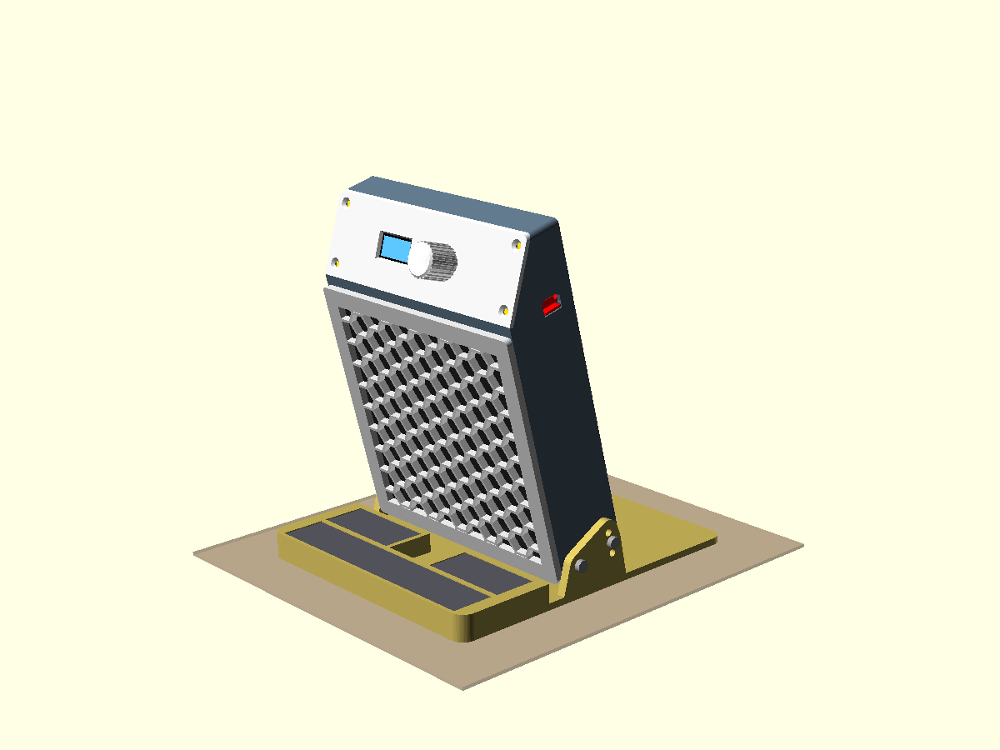

# USB-C Desk Fume Extractor

A small desk fume extractor that pulls solder smoke away from the work. It's the same box format as the $30-40 mains-powered units (YIHUA 948DQ and similar), with a square fan and a replaceable 130 mm carbon filter on the front. This one runs from an ordinary USB-C wall charger, and it has a dial for fan speed and a small screen showing the current speed. It uses a Noctua NF-A12x25 5V PWM fan driven by a SparkFun Thing Plus ESP32-S3, in a 3D-printed PETG case that tilts forward toward the work.



> [!TIP]
> **Get every SparkFun part in one click: <SPARKFUN_WISHLIST_URL>** (the shared wishlist link is not set up yet; until it is, use the product links in [Bill of materials](#bill-of-materials)).
> <sub>The SparkFun and Amazon links are referral links, so buying through them supports the project at no extra cost to you.</sub>

- **Firmware:** Arduino (ESP32-S3). 25 kHz PWM, tach read-back, stall warning, dial and OLED UI.
- **Enclosure:** parametric OpenSCAD, prints in PETG without supports. See [case/README.md](case/README.md).
- **Host tests:** the fan logic runs on your computer (`make -C firmware/test`), no hardware needed.

| Path | What's there | More detail |
|---|---|---|
| `firmware/fume_extractor/` | Arduino sketch (`fume_extractor.ino`, `fan_logic.h`, `config.h`) | [Build](#firmware-build-and-flash) |
| `firmware/test/` | Host tests (`make -C firmware/test`) | [Build](#firmware-build-and-flash) |
| `case/cad/fume_extractor_case.scad` | Case source (all parameters at the top) | [case/README.md](case/README.md) |
| `case/stl/` | Pre-exported printable parts | [case/README.md](case/README.md) |
| `docs/wiring.md` | Wiring diagram, pin choices, bench check | [docs/wiring.md](docs/wiring.md) |
| `docs/superpowers/specs/` | Design spec | [spec](docs/superpowers/specs/2026-10-16-fume-extractor-design.md) |

---

## Bill of materials

Power is any USB-C wall charger rated 5 V / 1 A or more, plus a USB-C cable. Total draw is under 0.6 A. No PD negotiation and no 12 V.

### SparkFun

| Qty | Part | Notes |
|---|---|---|
| 1 | [SparkFun Thing Plus ESP32-S3](https://www.sparkfun.com/sparkfun-thing-plus-esp32-s3.html?affiliate_code=rfxlS0eYyY) | Main board. USB-C power input, one Qwiic port. |
| 1 | [SparkFun Qwiic OLED 1.3" 128x64](https://www.sparkfun.com/sparkfun-qwiic-oled-1-3in-128x64.html?affiliate_code=rfxlS0eYyY) | Address 0x3D |
| 1 | [SparkFun Qwiic Twist RGB rotary encoder](https://www.sparkfun.com/sparkfun-qwiic-twist-rgb-rotary-encoder-breakout.html?affiliate_code=rfxlS0eYyY) | Address 0x3F |
| 1 | [SparkFun Qwiic Cable Kit](https://www.sparkfun.com/sparkfun-qwiic-cable-kit.html?affiliate_code=rfxlS0eYyY) | |

### Amazon

These are search links, not fixed product pages, so you can pick a well-reviewed, Prime-eligible listing. Check the model number and size against the notes.

| Qty | Part | Notes |
|---|---|---|
| 1 | [Noctua NF-A12x25 5V PWM fan](https://www.amazon.com/s?k=Noctua+NF-A12x25+5V+PWM&tag=colemangolfs-20) | Must be the **5V** version. The 12 V one will not work here. 120 x 120 x 25 mm, 4-pin. |
| 1 | [130 x 130 mm carbon filter pads, multipack](https://www.amazon.com/s?k=130x130mm+activated+carbon+filter+948DQ+replacement&tag=colemangolfs-20) | 948DQ-style replacements, 10 mm thick. Buy a multipack. |
| 1 | [2N7000 N-MOSFET](https://www.amazon.com/s?k=2N7000+TO-92+MOSFET&tag=colemangolfs-20) | TO-92. Any logic-level N-MOSFET works. |
| 1 | [Protoboard, about 50 x 30 mm](https://www.amazon.com/s?k=mini+protoboard+solderable+PCB+kit&tag=colemangolfs-20) | The case expects 50 x 30 mm with holes 2.5 mm in |
| 1 | [4-pin fan header](https://www.amazon.com/s?k=4+pin+PWM+fan+header+connector+2.54mm&tag=colemangolfs-20) | 2.54 mm pitch |
| 1 set | [Resistors: 10 k, 100 k, 100 ohm](https://www.amazon.com/s?k=resistor+assortment+kit+1%2F4W&tag=colemangolfs-20) | 1/4 W assortment is fine |
| 12 | [M3 heat-set inserts](https://www.amazon.com/s?k=M3+heat+set+inserts+brass+assortment&tag=colemangolfs-20) | 4.0 mm hole, 5.7 mm long or shorter |
| 1 set | [M3 screws](https://www.amazon.com/s?k=M3+screw+assortment+button+head+flat+head+ISO+7380&tag=colemangolfs-20) | 4 x M3x30 button head, 4 x M3x8 flat head |
| 4 | [M3 shoulder screws](https://www.amazon.com/s?k=M3+shoulder+screw+4mm+shoulder+6mm&tag=colemangolfs-20) | 4 mm shoulder x 6 mm, M3 thread 5 mm or shorter |
| 8 | [6 x 3 mm disc magnets](https://www.amazon.com/s?k=6x3mm+neodymium+disc+magnets+N52&tag=colemangolfs-20) | Check polarity before gluing |
| 1 set | [Small M2 and M2.5 screws](https://www.amazon.com/s?k=M2+M2.5+pan+head+screw+assortment&tag=colemangolfs-20) | M2.5 x 4, x 5, x 8 and M2 x 5 |
| 1 | [Hookup wire](https://www.amazon.com/s?k=22awg+silicone+hookup+wire+kit&tag=colemangolfs-20) | |

The full case hardware list (with where each screw goes) is in [case/README.md](case/README.md#hardware). Optional: rubber feet for the base plate and 3 mm foam tape around the fan.

---

## Build

1. **Print** the case. Settings and orientation are in [case/README.md](case/README.md#printing-petg). The STLs are in `case/stl/`.
2. **Wire** the protoboard and the Qwiic chain with [docs/wiring.md](docs/wiring.md). Qwiic chain: Thing Plus, OLED, Twist.
3. **Flash** the firmware (below) and run the bench check in [docs/wiring.md](docs/wiring.md#bench-check) **before** closing the case.
4. **Assemble** following [the assembly order](case/README.md#assembly-order).

### Firmware build and flash

Install the toolchain:

```bash
brew install arduino-cli   # macOS; see arduino-cli docs for Linux and Windows
arduino-cli config add board_manager.additional_urls https://espressif.github.io/arduino-esp32/package_esp32_index.json
arduino-cli core update-index
arduino-cli core install esp32:esp32
arduino-cli lib install "SparkFun Qwiic OLED Arduino Library" "SparkFun Qwiic Twist Arduino Library"
```

Run the host tests, then build and flash from the repository root:

```bash
make -C fume-extractor/firmware/test
FQBN="esp32:esp32:sparkfun_esp32s3_thing_plus:CDCOnBoot=cdc"
arduino-cli compile --fqbn "$FQBN" fume-extractor/firmware/fume_extractor
arduino-cli board list                    # find the port, e.g. /dev/cu.usbmodem101
arduino-cli compile --upload -p /dev/cu.usbmodem101 --fqbn "$FQBN" fume-extractor/firmware/fume_extractor
arduino-cli monitor -p /dev/cu.usbmodem101 -c baudrate=115200
```

`CDCOnBoot=cdc` is needed for serial output over the USB-C port. The monitor should show `oled=1 twist=1`.

**Troubleshooting:** on an Apple Silicon Mac without Rosetta, compiling fails with `bad CPU type in executable`, because arduino-cli's bundled `ctags` is x86-only. Install Rosetta with `softwareupdate --install-rosetta` and compile again. If no port appears, use a USB-C data cable, or hold BOOT, tap RESET, and release BOOT before uploading.

---

## Using it

- **Turn** the dial to change speed: Off, then 10% to 100% in 10% steps. The screen shows the speed large, with the measured RPM small underneath. The dial's light fades from blue (low) through green to red (high), and stays dim when Off.
- **Click** to toggle between Off and the last non-zero speed.
- On power-up it starts at the last-used speed, so plugging it in is enough to turn it on.
- After 10 minutes with no dial input the screen dims. The fan keeps running.
- **`FAN?`** appears on the screen, and the dial blinks red, when the PWM is above 20% and the tach reads 0 for 3 seconds. It means the fan is stalled, unplugged, or the tach wire has come loose. Check the fan cable and the fan's path for obstruction.

## Acceptance test

Put a thin smoke source (a hot iron touching flux, or rosin core solder) 15 cm in front of the filter at 100%. The plume should bend into the filter and not rise past it. If it fails, try 3 filter pads instead of 2 and then test again with 1 pad, before changing the fan.

## Not in v0.1

- Battery power.
- Wi-Fi, Bluetooth, app control, or remote control.
- Work lighting.
- Custom PCB. The plan is to hand-wire v1 on a protoboard and do a PCB later once it works.
- Air-quality sensing or auto-on.

## License

AGPL-3.0; see [LICENSE](../LICENSE). It covers the firmware, the case CAD and STLs, and the documentation.
