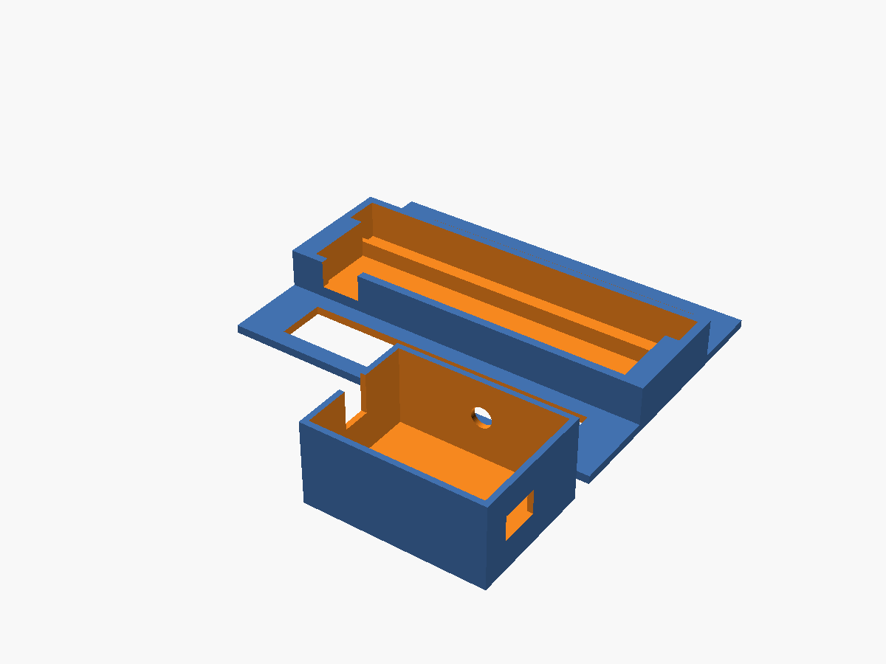

# Bench rig

A quick way to test the fan, filter and firmware before printing the full case. It uses a generic **ESP32 DevKit** and a bare **EC11 rotary encoder** (the common 5-pin kind with a push switch). There's no OLED and no Qwiic Twist.

When you plug in USB, the fan starts at the last saved speed, or 50% on first boot. Turn the dial to change the speed in 10% steps, and click to toggle Off and back. The serial monitor (115200) prints each speed change, plus the RPM every 5 s.



## Print

`stl/stand.stl` and `stl/box.stl`, or `part="both"` for a single plate (137 × 154 mm). Any material works, with no supports, a 0.2 mm layer height and 2 walls.

- **Stand:** the fan drops into the back pocket, and the 130 mm filter pad drops into the front pocket against the fan's intake face. Put the fan's airflow arrow pointing **away** from the filter. The fan lead exits through the notch at the back right.
- **Box:** an open-top tray for the DevKit, which sits on its header pins. The encoder goes through the front wall, held by its nut. USB comes out the left end, and the fan wires come out the slot at the right end.

To change sizes (for example a different DevKit or encoder), edit the parameters at the top of `bench_case.scad`, then run:

```bash
openscad -D 'part="stand"' -o stl/stand.stl bench_case.scad
openscad -D 'part="box"' -o stl/box.stl bench_case.scad
```

## Wiring (DevKit)

| From | To |
|---|---|
| Encoder **A** (outer pin of the 3-pin side) | GPIO32 |
| Encoder **B** (other outer pin) | GPIO33 |
| Encoder **C** (middle pin) | GND |
| Encoder switch (2-pin side), one pin | GPIO27 |
| Encoder switch, other pin | GND |
| Fan pin 2 (+5 V) | `5V` / `VIN` |
| Fan pin 1 (GND) | GND |
| Fan pin 3 (tach) | GPIO34, **plus a 10 kΩ resistor from GPIO34 to 3V3** |
| Fan pin 4 (PWM) | MOSFET drain or NPN collector (see below) |

The encoder needs no resistors, because the firmware turns on the internal pull-ups.

**Fan speed control.** The fan's PWM circuit is the same as in [docs/wiring.md](../docs/wiring.md), with GPIO4 as the PWM pin. Use an N-MOSFET (AO3400, BSS138 or 2N7000):
- gate to GPIO4 through 100 Ω, plus 100 kΩ from the gate to GND
- source to GND
- drain to fan pin 4

**Using a 2N3904 (or other small NPN) instead:**
- base to GPIO4 through **1 kΩ** (not 100 Ω), plus 100 kΩ from the base to GND
- emitter to GND
- collector to fan pin 4

2N3904 pinout: flat side facing you, legs down, **E B C** from left to right. The firmware is the same.

**No MOSFET on hand yet?** Leave fan pin 4 unconnected. The Noctua then runs at full speed when powered, so you can still check airflow, the filter fit and the RPM readout. The dial won't change the speed until the MOSFET is in.

## Flash

From the repository root:

```bash
arduino-cli compile --upload --fqbn esp32:esp32:esp32 -p /dev/cu.wchusbserial10 fume-extractor/firmware/fume_extractor
arduino-cli monitor -p /dev/cu.wchusbserial10 -c baudrate=115200
```

Your port name may differ; run `arduino-cli board list` to find it. On Apple Silicon without Rosetta, see the ctags note in the [project README](../README.md#firmware-build-and-flash). Expected boot output:

```
fume-extractor 0.1.0
oled=0 twist=0 encoder=1 level=5
```

## Dial feels wrong?

- **Needs two clicks per step:** set `ENC_STEPS_PER_DETENT = 2` in `firmware/fume_extractor/config.h`.
- **Jumps two steps per click:** set it to `8`.
- **Turns the wrong way:** set `ENC_DIRECTION = -1`, or swap the A and B wires.
