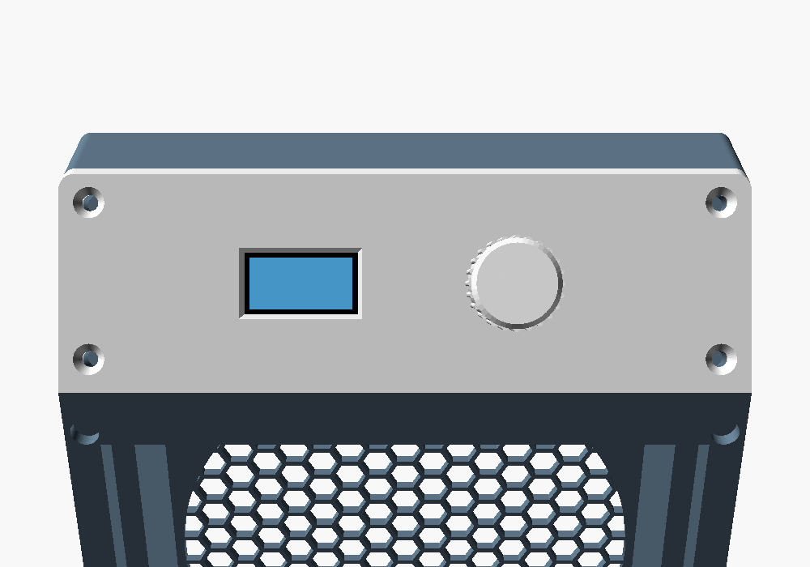

# USB-C Desk Fume Extractor – Case (v0.1)

A parametric OpenSCAD case for the USB-C desk fume extractor. It holds these parts:

- Noctua NF-A12x25 5V PWM fan (120 x 120 x 25)
- 130 x 130 x 10 mm activated-carbon filter pad (948DQ-style replacement)
- SparkFun Thing Plus ESP32-S3
- Generic 0.96" 128x64 SSD1306 I2C OLED module (27.3 x 27.8 mm, 4-pin header on the top edge)
- Bare EC11 rotary encoder with push switch (M7 x 0.75 bushing, 6 mm D shaft)
- ~50 x 30 mm protoboard (N-MOSFET PWM inverter, tach pull-up, fan header)

The Thing Plus outline, mounting holes and connector positions come from SparkFun's KiCad files, by way of `open-gps/case`. The fan and filter use their datasheet sizes. The OLED module and the EC11 use typical listing dimensions, which vary by vendor, so check them with calipers (see "Measure before you print"). Earlier versions of the pod lid held the SparkFun Qwiic OLED 1.3" and Qwiic Twist instead. They are in the git history (before the commit that added `render_pod_face.png`).




## Size

The case is 146 x 44.4 x 191.8 mm (W x D x H). The magnetic filter frame adds 4 mm at the front. The body is a 146 mm square fan box, with the control pod sitting on top of it. The tilt base is 158 x 199.4 mm. It reaches 75 mm in front of the filter and 80 mm behind the rear grille, and the case stands 11 mm above the desk at 0°. A 15 mm tall ballast plinth across the front of the base holds about 575 g of steel bar.

## Layout

- **Front:** the filter frame, a hex grille with 78% open area over the 126 mm window. Four 6 x 3 mm magnets hold it on. The filter pad sits in a 131 x 131 mm recess that is 9 mm deep, 1 mm shallower than the 10 mm pad. The frame's rim squeezes the pad's edges 1 mm onto the step behind the recess. That step is the seal, so all intake air goes through the carbon, and a thin or worn pad still seals. To remove the frame, hook a finger into the scoop under its bottom edge and peel it off from there (see Known limitations).
- **Inside the body, front to back:** the filter, a 2 mm air gap (room for the fan screw heads), the fan, a 6 mm exhaust plenum, then the rear wall. The fan drops into a 120.6 mm pocket from the front. Four M3 x 30 screws go through the fan's corner holes into heat-set inserts in pads at the back of the pocket.
- **Back:** a finger-guard grille, 8 mm hexes (across the corners) with 1.2 mm ribs, 116 mm across, 73% open.
- **Fan cable:** a 12 x 6.5 mm channel runs from the top of the plenum into the pod floor, so the fan's 4-pin plug passes straight through. Because it leaves from *behind* the fan, the pod (which is open to the room at the USB port) connects only to the exhaust side, and no unfiltered air can reach the fan's intake.
- **Pod (top):** the front face is tilted so it faces 30° above horizontal, toward you. The **pod lid** is that sloped face. It carries the OLED (window on the left) and the EC11 knob (on the right), and is held by four countersunk M3 screws into inserts in the pod's side walls. The window and the knob are a balanced pair: both at mid-height on the 46 mm slope, 22 mm either side of the centre line (x = 51 and 95 on the 146 mm face).
  - **OLED:** the 24 x 13 mm window (the 21.7 x 10.9 mm active area plus about 1 mm a side, with a 1 mm chamfer outside) sits over the active area, not the glass centre: the active area is in the upper part of the glass, so the window is 2.6 mm above the glass centre. The glass sits in a 0.6 mm pocket in the inside of the face, leaving 1.8 mm in front of it. The PCB lands on four printed bosses and is held by four M2 x 4 self-tapping screws from behind (1.6 mm pilots, stopping 0.6 mm short of the face). The header is on the top edge (up the slope). Its pin stubs and solder on the glass side sit in a relief slot, and there's at least 15 mm behind the PCB at the header for Dupont housings.
  - **EC11:** the bushing goes through a 7.4 mm hole. The body sits in a 0.4 mm pocket, so the face is 2.0 mm thick there, and the 5 mm bushing takes the face, a 0.5 mm washer and a 2 mm nut with 0.5 mm to spare. The 3-pin (A, C, B) side faces up the slope, the 2 switch pins face down. If your EC11 has a small anti-rotation tab on its face, snap it off: the nut holds it.
  - Keep the protoboard's fan header (with its plug) on the **rear half** of the board. The front half sits under the OLED and has room for parts up to 12 mm tall. Inside, on the floor: the protoboard on the left, and the Thing Plus on the right with its **USB-C and microSD in the right side wall**.
- **Tilt base:** the case hangs between two cheeks on a flat base plate, on four M3 shoulder screws into inserts in the shell's solid side walls. Each side has a pivot screw near the front-bottom and a lock screw 25 mm behind it. The cheeks have three lock holes, so the case tilts **forward by 0°, 15° or 30°** and the intake aims down at the work. To change the angle, take out the two lock screws, tip the case, and put them back in the other holes. The plate reaches 75 mm in front of the filter and 80 mm behind the case. The knob is about 190 mm up, and pressing it pushes the case backward, so the plate needs that rear reach plus weight at the front. A **ballast plinth** across the front of the plate has three open-top pockets for 25 x 12 mm steel flat bar: one 140 mm bar at the front and two 52 mm bars behind it, either side of a 30 mm finger notch that leaves room to reach the frame's finger scoop. With the steel fitted, the centre of mass stays well inside the footprint, and a 10 N press on the knob can't tip it at any tilt (see the table under Known limitations). The helping hands can stand on the plinth.

## Files

- `cad/fume_extractor_case.scad`: single source file. Set `part` to `shell`, `frame`, `pod_lid`, `base`, `knob`, `assembly`, `poses`, `exploded` or `pod_face`.
- `stl/`: pre-exported parts in print orientation.
- `render_assembly.png`, `render_poses.png`, `render_exploded.png`, `render_pod_face.png`: preview renders. `assembly` shows the tilt set by `view_tilt` (index into `tilts`).

To re-export a part:
```
openscad -D 'part="shell"' -o stl/shell.stl cad/fume_extractor_case.scad
```
Collision-check targets (`chk_shell`, `chk_frame`, `chk_pod_lid`, `chk_kickstand`, `chk_shell_frame`, `chk_shell_pod_lid`) intersect each part with the ghost components, or with each other. They should come back empty or zero-volume. Parts that touch by design, like the fan on its pads, the filter against the frame, a screw head on a cheek or a ballast bar on its pocket floor, give zero-volume faces. `chk_kickstand` (alias `chk_base`) tests the base, its screws and the ballast bars against the posed case at 0°, 15° and 30°. Three extra targets are included: `chk_desk` checks that nothing goes below the desk at any tilt, `chk_ghosts` checks that the floor boards clear the OLED and the EC11 (including the OLED's Dupont keep-out and the encoder's wire keep-out) and that the OLED and EC11 clear each other, and `chk_knob` checks the seated knob against the case, the nut and the OLED (everything except the shaft it grips). The part `base` is also available as `kickstand`. Open-area numbers come from `--summary area` on `area_rear_open` / `area_rear_total` / `area_front_open` / `area_front_total`.

To re-render the previews:
```
openscad -D 'part="assembly"' --imgsize=1200,900 --camera=480,-380,260,73,0,85 --viewall --autocenter -o render_assembly.png cad/fume_extractor_case.scad
openscad -D 'part="poses"' --imgsize=1500,650 --camera=900,200,100,73,200,100 --projection=ortho --viewall --autocenter -o render_poses.png cad/fume_extractor_case.scad
openscad -D 'part="exploded"' --imgsize=1200,900 --camera=-400,-330,250,73,-40,90 --viewall --autocenter -o render_exploded.png cad/fume_extractor_case.scad
openscad -D 'part="pod_face"' --imgsize=1000,700 --camera=73,-248.3,321.9,73,11.5,171.9 --colorscheme=Tomorrow -o render_pod_face.png cad/fume_extractor_case.scad
```

## Hardware

| Qty | Item | Where |
|---|---|---|
| 12 | M3 heat-set insert, 4.0 mm hole, ≤5.7 mm long | 4 in the fan pads (back of the fan pocket), 4 in the pod side walls, 4 in the shell's side walls (tilt pivot + lock) |
| 4 | M3 x 30 button head (ISO 7380) | fan → pad inserts, from the front. The heads sit in the 2 mm gap in front of the fan |
| 4 | M3 x 8 flat head (ISO 10642) | pod lid → inserts (countersunk, flush) |
| 4 | M3 shoulder screw (ISO 7379), **4 mm shoulder x 6 mm**, M3 thread ≤5 mm | base cheeks → shell side walls: pivot + lock, both sides |
| 1 | Steel flat bar, 25 x 12 mm (1" x 1/2" also fits), about 250 mm: cut one 140 mm and two 52 mm pieces | ballast pockets in the base plinth. **Needed** for stability (about 575 g) |
| 4 | Small rubber feet (optional) | under the base plate |
| 8 | 6 x 3 mm disc magnet (N52) | 4 in the shell's front corners, 4 in the frame. **Check polarity** |
| 2 | M2.5 x 5 pan head (self-tapping into PETG) | Thing Plus → floor standoffs |
| 4 | M2 x 4 pan head, self-tapping (PT/plastite style) | OLED → lid bosses, from behind through the PCB. 1.6 mm pilots, 2.7 mm of thread. Longer screws will dimple the face |
| 1 | M7 x 0.75 nut + washer (come with the EC11) | EC11 → lid. Washer under the nut, 2 mm nut or thinner |
| 4 | M2 x 5 pan head (self-tapping), or foam tape | protoboard → floor standoffs |
| 1 | Strip of 3 mm foam tape (optional) | around the fan's front edge, if you want an extra seal |

## Printing (PETG)

- 0.4 mm nozzle, 0.2 mm layers, 3 walls, 15–20% gyroid.
- No supports needed on any part. The pod prints without supports because the shell prints rear-down. The pod's insert blocks have chamfered undersides, and the floor standoffs are short stubs.
- **Shell:** print rear-down (grille on the bed). It's the big one: a 146 x 192 mm footprint, 44.4 mm tall.
- **Frame:** print face-down.
- **Pod lid:** print face-down. A textured plate gives a nice front finish.
- **Base:** print flat, as exported. The cheeks and the ballast plinth stand up from the plate, and the pockets are open on top, so there's nothing to bridge. The footprint is 158 x 199 mm. A solid or high-infill plate adds useful weight low down.
- **Knob:** print upright (bore down). It's a press fit on the 6 mm D shaft: a 6.15 mm bore with three crush ribs, and a D-flat at 4.5 mm over the top 11.5 mm of the 14.5 mm bore.

## Assembly order

1. Press the 12 inserts:
   - 4 into the fan pads. They sit about 36 mm in from the front face, at the back of the fan pocket, so you need a **long insert tip**, or a plain tip on an extension.
   - 4 into the pod side walls, through the open pod face.
   - 4 into the shell's outer side walls near the bottom: pivot and lock, both sides.
2. Press the magnets into the shell and frame corners. Put the frame on the shell first and check that it pulls on, not off, before gluing any magnet.
3. Screw the Thing Plus to the floor (USB-C into the right-wall opening) and the protoboard to its standoffs.
4. Fan: the label/strut side faces **back** (air flows front → back). Turn the fan so its cable comes out near the top, a little left of centre. Feed the plug up through the channel at the top of the plenum, then seat the fan and fit the four M3 x 30 screws. Plug the fan into the protoboard header.
5. Solder or plug the wires onto the OLED header and the EC11 pins first (see the wiring note in the main README). Lay the OLED glass-first into its pocket (header up the slope) and fit the four M2 x 4 screws. Push the EC11 through from behind (3-pin side up the slope) and fit the washer and nut outside. Then screw the lid on.
6. Drop in the filter pad, then put the frame on. Line the knob's flat up with the shaft's flat and push it on until the shaft bottoms in the bore. That leaves a 1 mm gap above the nut for the push switch.
7. Drop the three steel bars into the base's ballast pockets (the 140 mm bar at the front, the 52 mm bars behind it) and fix them with a dab of silicone or hot glue. Don't skip them: without the steel, a press on the knob tips the case backward at about 5 N.
8. Stand the case between the base cheeks and fit the two pivot shoulder screws. Then fit the two lock screws in the hole for the tilt you want: lowest hole 0°, middle 15°, top 30°.

## Measure before you print

These values were estimated or depend on the parts you buy. Every one is a single parameter at the top of the `.scad` file.

- **`filter` / `filter_crush`:** pad thickness (default 10 mm) and how much the frame squeezes it (1 mm; the recess is 9 mm deep). Pads 9 mm or thinner won't be compressed. If yours are thinner, reduce `filter`.
- **`proto` / `proto_hole_in`:** protoboard size and hole inset (default 50 x 30, holes 2.5 mm in). Generic boards vary. Foam tape works if the holes don't line up.
- **`cable_slot`:** 12 x 6.5 mm passes a standard 4-pin fan plug. A fat extension-cable plug may need more.
- **`oled_pcb` / `oled_hole_in` / `oled_glass` / `oled_glass_top` / `oled_aa_top`:** 0.96" OLED module PCB 27.3 x 27.8 x 1.2 mm, M2 holes 2.0 mm in from each edge, glass 26.7 x 19.3 x 1.5 mm with its top edge 4.5 mm below the PCB's header edge, active area 1.6 mm below the glass top. These are typical listing values and vary between vendors. The glass thickness sets where the PCB lands (boss height), and `oled_glass_top` + `oled_aa_top` set where the window sits. Measure your module. The bottom bosses are only 0.2 mm from the glass's bottom edge.
- **`enc_body` / `enc_shaft_L` / `enc_flat_L` / `enc_nut`:** EC11 body 12.5 x 13.5 x 6.5 mm, shaft 20 mm from the mounting face (the common "L20", 15 mm past the bushing) with a 12 mm flat, nut 2 mm thick. The knob's bore depth follows `enc_shaft_L`: with L20 the shaft stands 15.5 mm past the nut, and the bore is 14.5 mm. If yours is shorter, set `enc_shaft_L` and re-export the knob, or the knob won't seat against the shaft's end.
- **`mag_fit`:** the magnet pocket is 6.15 mm. If your printer's holes come out true to size, glue the magnets in.

## Known limitations / next steps

- **Bigger than the spec's 140 mm.** The front is 146 mm and the pod is 44 mm deep, not 140 x 40. A 6 mm magnet needs at least 6.5 mm of rim outside the 131 mm filter recess, and the depth comes from the 2 mm screw-head gap and the 6 mm exhaust plenum. This size was accepted.
- **The base takes desk space.** The plate is 199 mm deep: 75 mm in front of the filter, under the work area, and 80 mm behind the case. The helping hands can stand on the plinth. A shorter `base_reach`, or leaving out the steel, makes the case easier to tip.
- **Heavy shell.** The body walls around the fan pocket are solid (12.7 mm). The infill sets the weight, which also keeps the case planted. Hollowing them would save filament.
- **Stability (estimated).** Total about 1190 g: about 575 g of steel ballast (25 x 12 mm bar), the fan, and the printed parts' mass estimated from their volume (shell at 45% fill, other parts at 80%, PETG 1.27 g/cm³). The centre of mass sits about 40–42 mm above the desk. Each row below is the force that tips the case:
  - *Forward pull at the frame:* horizontal, toward you, tips it over the base's front edge.
  - *Knob press:* along the knob's axis (into the sloped face, so rearward and down at 0°, horizontal at 30°), at the knob top. It tips the case over the base's rear edge.
  - *Rearward push at the pod top:* horizontal, away from you, at the top front edge of the pod, over the rear edge.

  | | 0° | 15° | 30° |
  |---|---|---|---|
  | COM → front edge | 63 mm | 55 mm | 47 mm |
  | COM → rear edge | 137 mm | 145 mm | 152 mm |
  | Forward pull, frame centre | 8.7 N | 8.1 N | 7.9 N |
  | Forward pull, frame top edge | 4.7 N | 4.3 N | 4.1 N |
  | Knob press, along its axis (rearward tip) | 15.1 N | 12.4 N | 10.7 N |
  | Rearward push, pod top (rearward tip) | 7.9 N | 8.4 N | 9.6 N |

  These were worked out with the earlier Qwiic Twist knob. The EC11 knob's axis is 3.7 mm lower on the slope (the knob is taller, but moving it along its own axis doesn't change the lever), which shortens the knob-press lever arm by about 4%, so the knob-press row is slightly conservative now.

  Before the steel and the longer rear reach, the knob press tipped the case backward at only 1.3 N (0°), 1.8 N (15°) and 2.2 N (30°), which is less than an encoder's push switch needs. The 30° knob press is the tightest case. It stays above 10 N for shell infill from 30% to 60% and base infill from 30% to 100%. **Without the steel** the knob press tips it at about 4.9–5.9 N, so fit the ballast. A press on the knob can't tip the case forward at any tilt.

  The magnet pairs sit only about 0.4 mm apart, so pulling the frame straight off probably takes several newtons, which is more than the frame-top row allows. **Only peel the frame from the finger scoop at its bottom edge**, and steady the base with your other hand. The scoop is 6–15 mm above the desk, depending on the tilt, so it would take roughly 50–90 N there to tip the case. Never pull the frame by its middle or top edge.
- **Change the filter at 0°.** At 30° the frame's bottom edge is only about 2 mm above the plate, too little to get a finger into the scoop. Move the lock screws to the 0° hole first (the edge is then 7 mm above the plate, and the plinth's finger notch is in front of the scoop), then peel the frame off.
- **Fan side gap:** 0.3 mm around the fan connects the intake side to the exhaust plenum. That only recirculates filtered air, but the optional foam strip closes it.
