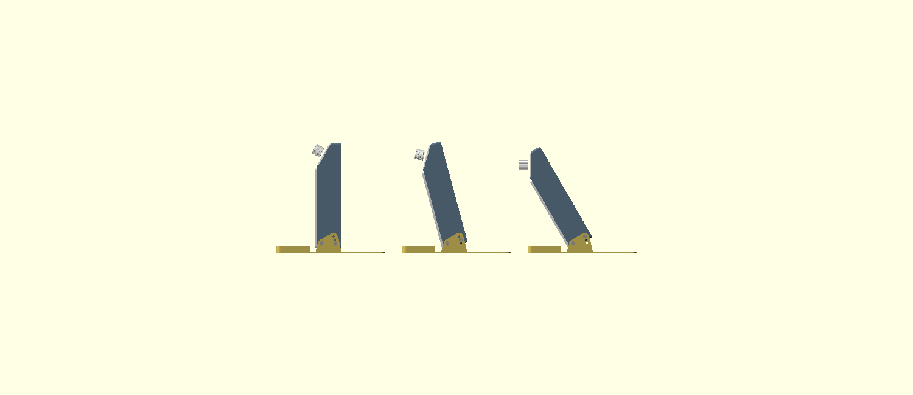

# USB-C Desk Fume Extractor – Case (v0.1)

A parametric OpenSCAD case for the USB-C desk fume extractor. It holds these parts:

- Noctua NF-A12x25 5V PWM fan (120 x 120 x 25)
- 130 x 130 x 10 mm activated-carbon filter pad (948DQ-style replacement)
- SparkFun Thing Plus ESP32-S3
- SparkFun Qwiic OLED 1.3" 128x64
- SparkFun Qwiic Twist RGB Rotary Encoder
- ~50 x 30 mm protoboard (2N7000 PWM inverter, tach pull-up, fan header)

The Thing Plus, OLED and Twist outlines, mounting holes and connector positions come from SparkFun's Eagle and KiCad source files, by way of `open-gps/case`. The fan and filter use their datasheet sizes. Only the parts listed under "Measure before you print" were estimated.




## Size

The case is 146 x 44.4 x 191.8 mm (W x D x H). The magnetic filter frame adds 4 mm at the front. The body is a 146 mm square fan box, with the control pod sitting on top of it. The tilt base is 158 x 125.4 mm. It reaches 75 mm in front of the filter, and the case stands 11 mm above the desk at 0°.

## Layout

- **Front:** the filter frame, a hex grille with 78% open area over the 126 mm window. Four 6 x 3 mm magnets hold it on. The filter pad sits in a 131 x 131 mm recess that is 9 mm deep, 1 mm shallower than the 10 mm pad. The frame's rim squeezes the pad's edges 1 mm onto the step behind the recess. That step is the seal, so all intake air goes through the carbon, and a thin or worn pad still seals. To remove the frame, hook a finger into the scoop under its bottom edge and peel it off from there (see Known limitations).
- **Inside the body, front to back:** the filter, a 2 mm air gap (room for the fan screw heads), the fan, a 6 mm exhaust plenum, then the rear wall. The fan drops into a 120.6 mm pocket from the front. Four M3 x 30 screws go through the fan's corner holes into heat-set inserts in pads at the back of the pocket.
- **Back:** a finger-guard grille, 8 mm hexes (across the corners) with 1.2 mm ribs, 116 mm across, 73% open.
- **Fan cable:** a 12 x 6.5 mm channel runs from the top of the plenum into the pod floor, so the fan's 4-pin plug passes straight through. Because it leaves from *behind* the fan, the pod (which is open to the room at the USB port) connects only to the exhaust side, and no unfiltered air can reach the fan's intake.
- **Pod (top):** the front face is tilted so it faces 30° above horizontal, toward you. The **pod lid** is that sloped face. It carries the OLED (window on the left) and the Twist (knob on the right), and is held by four countersunk M3 screws into inserts in the pod's side walls. Inside, on the floor: the protoboard on the left, and the Thing Plus on the right with its **USB-C and microSD in the right side wall**.
- **Tilt base:** the case hangs between two cheeks on a flat base plate, on four M3 shoulder screws into inserts in the shell's solid side walls. Each side has a pivot screw near the front-bottom and a lock screw 25 mm behind it. The cheeks have three lock holes, so the case tilts **forward by 0°, 15° or 30°** and the intake aims down at the work. To change the angle, take out the two lock screws, tip the case, and put them back in the other holes. The plate reaches 75 mm in front of the filter, so the centre of mass stays far inside the footprint (see the table under Known limitations).

## Files

- `cad/fume_extractor_case.scad`: single source file. Set `part` to `shell`, `frame`, `pod_lid`, `base`, `knob`, `assembly`, `poses` or `exploded`.
- `stl/`: pre-exported parts in print orientation.
- `render_assembly.png`, `render_poses.png`, `render_exploded.png`: preview renders. `assembly` shows the tilt set by `view_tilt` (index into `tilts`).

To re-export a part:
```
openscad -D 'part="shell"' -o stl/shell.stl cad/fume_extractor_case.scad
```
Collision-check targets (`chk_shell`, `chk_frame`, `chk_pod_lid`, `chk_kickstand`, `chk_shell_frame`, `chk_shell_pod_lid`) intersect each part with the ghost components, or with each other. They should come back empty or zero-volume. Parts that touch by design, like the fan on its pads, the filter against the frame or a screw head on a cheek, give zero-volume faces. `chk_kickstand` (alias `chk_base`) tests the base and its screws against the posed case at 0°, 15° and 30°. Two extra targets are included: `chk_desk` checks that nothing goes below the desk at any tilt, and `chk_ghosts` checks that the floor boards clear the lid-mounted boards. The part `base` is also available as `kickstand`. Open-area numbers come from `--summary area` on `area_rear_open` / `area_rear_total` / `area_front_open` / `area_front_total`.

To re-render the previews:
```
openscad -D 'part="assembly"' --imgsize=1200,900 --camera=480,-380,260,73,0,85 --viewall --autocenter -o render_assembly.png cad/fume_extractor_case.scad
openscad -D 'part="poses"' --imgsize=1500,650 --camera=900,200,100,73,200,100 --projection=ortho --viewall --autocenter -o render_poses.png cad/fume_extractor_case.scad
openscad -D 'part="exploded"' --imgsize=1200,900 --camera=-400,-330,250,73,-40,90 --viewall --autocenter -o render_exploded.png cad/fume_extractor_case.scad
```

## Hardware

| Qty | Item | Where |
|---|---|---|
| 12 | M3 heat-set insert, 4.0 mm hole, ≤5.7 mm long | 4 in the fan pads (back of the fan pocket), 4 in the pod side walls, 4 in the shell's side walls (tilt pivot + lock) |
| 4 | M3 x 30 button head (ISO 7380) | fan → pad inserts, from the front. The heads sit in the 2 mm gap in front of the fan |
| 4 | M3 x 8 flat head (ISO 10642) | pod lid → inserts (countersunk, flush) |
| 4 | M3 shoulder screw (ISO 7379), **4 mm shoulder x 6 mm**, M3 thread ≤5 mm | base cheeks → shell side walls: pivot + lock, both sides |
| 4 | Small rubber feet (optional) | under the base plate |
| 8 | 6 x 3 mm disc magnet (N52) | 4 in the shell's front corners, 4 in the frame. **Check polarity** |
| 2 | M2.5 x 5 pan head (self-tapping into PETG) | Thing Plus → floor standoffs |
| 4 | M2.5 x 4 pan head | OLED → lid (longer screws will dimple the lid face) |
| 4 | M2.5 x 8 pan head | Twist → lid bosses |
| 4 | M2 x 5 pan head (self-tapping), or foam tape | protoboard → floor standoffs |
| 1 | Strip of 3 mm foam tape (optional) | around the fan's front edge, if you want an extra seal |

## Printing (PETG)

- 0.4 mm nozzle, 0.2 mm layers, 3 walls, 15–20% gyroid.
- No supports needed on any part. The pod prints without supports because the shell prints rear-down. The pod's insert blocks have chamfered undersides, and the floor standoffs are short stubs.
- **Shell:** print rear-down (grille on the bed). It's the big one: a 146 x 192 mm footprint, 44.4 mm tall.
- **Frame:** print face-down.
- **Pod lid:** print face-down. A textured plate gives a nice front finish.
- **Base:** print flat, as exported. The cheeks stand up from the plate. A solid or high-infill plate adds useful weight low down.
- **Knob:** print upright. Use clear or translucent PETG so the Twist's RGB light shows through the centre light pipe.

## Assembly order

1. Press the 12 inserts:
   - 4 into the fan pads. They sit about 36 mm in from the front face, at the back of the fan pocket, so you need a **long insert tip**, or a plain tip on an extension.
   - 4 into the pod side walls, through the open pod face.
   - 4 into the shell's outer side walls near the bottom: pivot and lock, both sides.
2. Press the magnets into the shell and frame corners. Put the frame on the shell first and check that it pulls on, not off, before gluing any magnet.
4. Screw the Thing Plus to the floor (USB-C into the right-wall opening) and the protoboard to its standoffs.
5. Fan: the label/strut side faces **back** (air flows front → back). Turn the fan so its cable comes out near the top, a little left of centre. Feed the plug up through the channel at the top of the plenum, then seat the fan and fit the four M3 x 30 screws. Plug the fan into the protoboard header.
6. Screw the OLED (glass against the lid) and the Twist (shaft through the hole) to the lid, connect Qwiic Thing Plus → OLED → Twist, and screw the lid on.
7. Drop in the filter pad, then put the frame on. Push the knob onto the shaft.
8. Stand the case between the base cheeks and fit the two pivot shoulder screws. Then fit the two lock screws in the hole for the tilt you want: lowest hole 0°, middle 15°, top 30°.

## Measure before you print

These values were estimated or depend on the parts you buy. Every one is a single parameter at the top of the `.scad` file.

- **`filter` / `filter_crush`:** pad thickness (default 10 mm) and how much the frame squeezes it (1 mm; the recess is 9 mm deep). Pads 9 mm or thinner won't be compressed. If yours are thinner, reduce `filter`.
- **`proto` / `proto_hole_in`:** protoboard size and hole inset (default 50 x 30, holes 2.5 mm in). Generic boards vary. Foam tape works if the holes don't line up.
- **`cable_slot`:** 12 x 6.5 mm passes a standard 4-pin fan plug. A fat extension-cable plug may need more.
- **`oled_glass_t`:** glass plus adhesive thickness (default 1.6). This sets the OLED boss height.
- **`enc_body` / `enc_hole_d`:** encoder body 12.4 x 13.4 x 7.8 mm, from a third-party model of COM-15141. The lid hole clears an M9 bushing.
- **`mag_fit`:** the magnet pocket is 6.15 mm. If your printer's holes come out true to size, glue the magnets in.

## Known limitations / next steps

- **Bigger than the spec's 140 mm.** The front is 146 mm and the pod is 44 mm deep, not 140 x 40. A 6 mm magnet needs at least 6.5 mm of rim outside the 131 mm filter recess, and the depth comes from the 2 mm screw-head gap and the 6 mm exhaust plenum. This size was accepted.
- **The base takes desk space.** The plate reaches 75 mm in front of the filter, under the work area. The helping hands can stand on it. A shorter `base_reach` makes the case easier to tip.
- **Heavy shell.** The body walls around the fan pocket are solid (12.7 mm). The infill sets the weight, which also keeps the case planted. Hollowing them would save filament.
- **Stability (estimated).** Total about 550 g, with the fan included and the printed parts' mass estimated from their volume (shell at 45% fill, other parts at 80%). The table shows the horizontal forward pull, at the frame, that would tip the case over the base's front edge:

  | Tilt | COM → front edge | COM → rear edge | Tips at (frame centre) | Tips at (frame top edge) |
  |---|---|---|---|---|
  | 0° | 91 mm | 34 mm | 5.9 N | 3.2 N |
  | 15° | 74 mm | 51 mm | 5.1 N | 2.7 N |
  | 30° | 58 mm | 68 mm | 4.5 N | 2.4 N |

  The magnet pairs sit only about 0.4 mm apart, so pulling the frame straight off probably takes several newtons, which is more than the table allows. **Only peel the frame from the finger scoop at its bottom edge**, and steady the base with your other hand. The scoop is 6–11 mm above the desk, depending on the tilt, so it would take roughly 45–50 N there to tip the case. Never pull the frame by its middle or top edge.
- **Fan side gap:** 0.3 mm around the fan connects the intake side to the exhaust plenum. That only recirculates filtered air, but the optional foam strip closes it.
