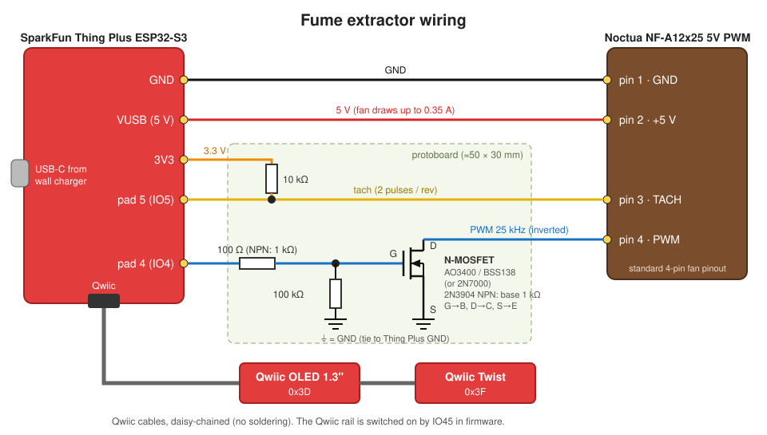

# Wiring

SparkFun Thing Plus ESP32-S3, Noctua NF-A12x25 5V PWM fan (4-pin), 2N7000 (or AO3400 /
BSS138) low-side PWM inverter, Qwiic OLED 1.3" and Qwiic Twist.

Fan connector pins: 1 = GND, 2 = +5 V, 3 = tach, 4 = PWM.



The same circuit as text:

```
 USB-C ──► Thing Plus ESP32-S3

   VUSB ──────────────────────────────────► Fan pin 2 (+5 V)
   GND  ──────────────────────────────────► Fan pin 1 (GND)

   3V3 ───[10k]───┬─────────────────────────► Fan pin 3 (tach)
                  └──────────────────────────► pad "5" (IO5)

   pad "4" (IO4) ──[100R]──┬── 2N7000 gate
                           └──[100k]── GND
   2N7000 drain  ────────────────────────► Fan pin 4 (PWM)
   2N7000 source ────────────────────────► GND

   Qwiic ──► OLED ──► Twist   (chain; IO45 powers the Qwiic rail)
```

Using a generic ESP32 DevKit instead of the Thing Plus? Same circuit, different pins: PWM = GPIO4, tach = GPIO34, fan +5 V from the `5V`/`VIN` pin, and the OLED/Twist on a Qwiic jumper cable to 3V3, GND, GPIO21 (SDA), GPIO22 (SCL). See [the README](../README.md#using-a-generic-esp32-devkit-instead).

Pad naming: pads are named by raw ESP32 IO number (SparkFun's hardware overview says the
PTH pads are labeled that way). Arduino's `GPIO3`/`GPIO4` aliases are a different scheme
(GPIO3 = IO5) and are not used. Silkscreen text and header position (left/right, Nth from
top) could not be confirmed from SparkFun's docs here; check the board or the graphical
datasheet for the pads marked 4 and 5 before soldering.

Notes:
- MOSFET choice: the 2N7000's gate threshold can be as high as 3 V, so at the ESP32's
  3.3 V gate drive some parts only half turn on. A true logic-level N-MOSFET is the safer
  choice: **AO3400** (V_GS(th) 1.45 V max) or **BSS138** (1.5 V max). Both are SOT-23, so
  mount it on a SOT-23 adapter and wire it by pin name (gate, drain, source): the TO-92
  2N7000's pin order is different. The diagram is the same for all three.
- The MOSFET inverts: gate high pulls fan PWM low. The firmware compensates
  (`gateDuty8()`), so 100% = gate duty 0.
- The fan's PWM pin is pulled up internally, so a floating gate means full speed
  (fail-safe).
- Tach is open-collector, 2 pulses per revolution, hence the 10 kΩ pull-up to 3V3.
- Pin choices are explained in `firmware/fume_extractor/config.h`.

## Bench check

Flash the sketch and confirm each item. The serial monitor needs the sketch built with the `CDCOnBoot=cdc` FQBN option shown in the [project README](../README.md#firmware-build-and-flash), otherwise it stays blank.

- [ ] Serial (115200) shows `oled=1 twist=1`.
- [ ] The dial steps the fan 0-100% in 10% steps.
- [ ] Click toggles Off and back to the previous speed.
- [ ] 100% reaches about 1900 rpm. If it's lower, the fan isn't getting a clean full-speed
      signal: check the gate wiring and the MOSFET. Also check the other end: Off must read
      0 rpm, and the 10% RPM must be well below the 50% RPM. If Off doesn't stop the fan, or
      the low speeds run fast, the MOSFET isn't fully switching on (fit an AO3400 or BSS138
      instead of the 2N7000).
- [ ] Run at 100% for 10 minutes. There must be no brownout or reset: the serial monitor shows
      no reboot (the `fume-extractor` boot line doesn't appear again and the port doesn't drop).
      VUSB, measured with a meter between fan pins 2 and 1, stays above 4.5 V. If it doesn't, the
      VUSB path can't carry the fan's 0.35 A: use a stronger charger or a shorter cable, or feed
      the fan from a separate USB-C power breakout.
- [ ] Pulling the fan's tach wire at 50% shows `FAN?` within 6 s (Twist blinks red).
- [ ] Replugging the tach wire clears `FAN?` and restores the RPM readout.
- [ ] Unplugging and replugging USB power restores the saved speed.
- [ ] Booting with the OLED cable removed still spins the fan at the saved speed.
